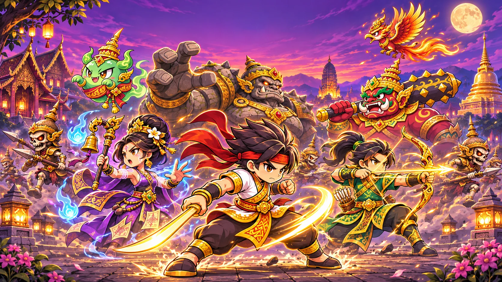

# MAHA COMBO — มหาคอมโบ

เกมฟันผ่านด่านแนว side-scroller (เล่นในเบราว์เซอร์) — ฟันศัตรูเติมเกจ แล้วปล่อย **คอมโบสกิลยาว 5 วิ – 1 นาที** ด้วยปุ่มเดียว

## อาชีพ (เลือกหลังหน้าปก แล้วเลือกความยาก)
| อาชีพ | เล่นยังไง | สกิล |
|---|---|---|
| นักดาบ | ฟันระยะประชิด | 18 ท่า |
| หมอผี | ยิงไฟวิญญาณ เรียกผี สาป ดูดเลือด | 9 ท่า: ลูกไฟวิญญาณ, กระดิ่งเรียกวิญญาณ, ยันต์ระเบิด, กะโหลกบิน, มือผีโผล่, เรียกผีพราย, คำสาปตรึง, ดูดวิญญาณ, พิธีกรรมมรณะ |
| นักธนู | ยิงไกล | 9 ท่า: ยิงรัว, ธนูกระจาย, ธนูทะลวง, ธนูระเบิด, ยิงกลางอากาศ, ฝนธนู, ธนูเถาวัลย์, ศรหงส์ทอง, ศรเทวะ |

แต่ละอาชีพมีเซฟ เงิน ของ และคอมโบซ่อนแยกกัน

## วิธีเล่น
เปิด `index.html` ในเบราว์เซอร์ได้เลย

| ปุ่ม | ทำอะไร |
|---|---|
| A / D (หรือ ← →) | เดิน |
| S (หรือ Space) | กระโดด |
| Z | ฟัน (กดค้างได้) |
| X | ปล่อยคอมโบ (ต้องเกจเต็ม) |
| C | จัดคอมโบ |
| V | เติมเกจทันที (ไว้ทดสอบ) |
| Enter | เริ่มเล่น / ด่านต่อไป |
| M / N | ปิดเสียงทั้งหมด / เปิด-ปิดเพลง |

กดได้ทั้งคีย์บอร์ดภาษาไทยและอังกฤษ

## ระบบ
- แมพยาวชั้นเดียว เดินไปทางขวา กำจัดศัตรูให้ครบ แล้วเข้าประตูวาร์ปท้ายแมพ
- สกิลย่อย 18 อัน ปลดล็อกด่านละ 2 อัน เอามาเรียงต่อกันเป็นคอมโบเดียว
- คอมโบซ่อน 10 คู่ — เรียงบางสกิลติดกันจะได้ดาเมจคูณเพิ่ม
- จบคอมโบ: สโลว์โม → จอดำ → ฟันกระจาย 7 แนว จอแตก ตัวเอกวาร์ปไล่ฟันศัตรูที่ระเบิดทีละตัว → สรุปคะแนนและแรงก์ (B ถึง SSS)
- มอนสเตอร์ 5 แบบ: ผีน้อย, ทหารโครงกระดูก, ปักษาไฟ (บินโฉบ), ยักษ์, ยักษ์หินทวารบาล (เฝ้าหน้าประตูวาร์ปตั้งแต่ด่าน 2)
- เลือดมอนสเตอร์คูณ 1.35 เท่าทุกด่าน
- อุปกรณ์ 3 ช่อง (อาวุธ / เกราะ / เครื่องราง) 3 ระดับ (ธรรมดา / หายาก / ตำนาน) ดรอปจากมอนสเตอร์ ของยิ่งด่านสูงยิ่งแรง เก็บแล้วสวมให้อัตโนมัติถ้าดีกว่าของเดิม เปลี่ยนเองได้ที่หน้า C

## เมือง (หลังเข้าประตูวาร์ป หรือตอนแพ้)
- **สกิล**: จัดคอมโบ
- **อุปกรณ์**: 6 ช่อง (อาวุธ เกราะ หมวก รองเท้า เครื่องราง แหวน) · 5 ระดับ (ธรรมดา ดี หายาก มหากาพย์ ตำนาน) · ของระดับดีขึ้นไปมีค่าพลังเสริมสุ่ม เช่น ดูดเลือด ความเร็ว แรงคริ เงิน เวลาคอมโบ
- **ร้านค้า**: ลุงพ่อค้า ของเปลี่ยนทุกด่าน + ขายหินตีบวก (จำกัด 3 ก้อนต่อด่าน)
- **ตีบวก**: ช่างตีเหล็ก ตีได้ถึง +15 ใช้เงิน + หินตีบวก ยิ่งสูงโอกาสสำเร็จยิ่งต่ำ
- ฟันมอนได้เงินทุกตัว · หินตีบวกดรอปยาก (ยักษ์หินดรอปบ่อยสุด)

## โหมดความยาก
| | ง่าย | ปกติ | ยาก |
|---|---|---|---|
| เลือดมอน | น้อย, โต ×1.22/ด่าน | โต ×1.35/ด่าน | หนา, โต ×1.5/ด่าน |
| มอนตีแรง | ×0.6 | ×1 | ×1.45 |
| เงิน / หิน / ของดรอป | เยอะ | ปกติ | น้อย |
| ราคาร้าน | ถูก | ปกติ | แพง |
| ตีบวกล้มเหลวลดขั้น | ไม่ลด | ตั้งแต่ +10 | ตั้งแต่ +7 |

เปลี่ยนโหมดได้ที่แท็บ "วิธีเล่น" ในเมือง

## ไฟล์
- `index.html` — หน้าเกม + หน้าจัดคอมโบ
- `game.js` — โค้ดเกมทั้งหมด
- `assets/` — ภาพตัวละคร ศัตรู ฉาก ไอคอน และเอฟเฟกต์ (วาดด้วย ChatGPT แล้วตัดเป็นเฟรม)

เล่นออนไลน์: https://mozila023.github.io/project-vice/

โปรเจกต์เก่า (เกมเกาะ Godot) ยังย้อนดูได้ในประวัติ git ที่ commit `159dfda`
